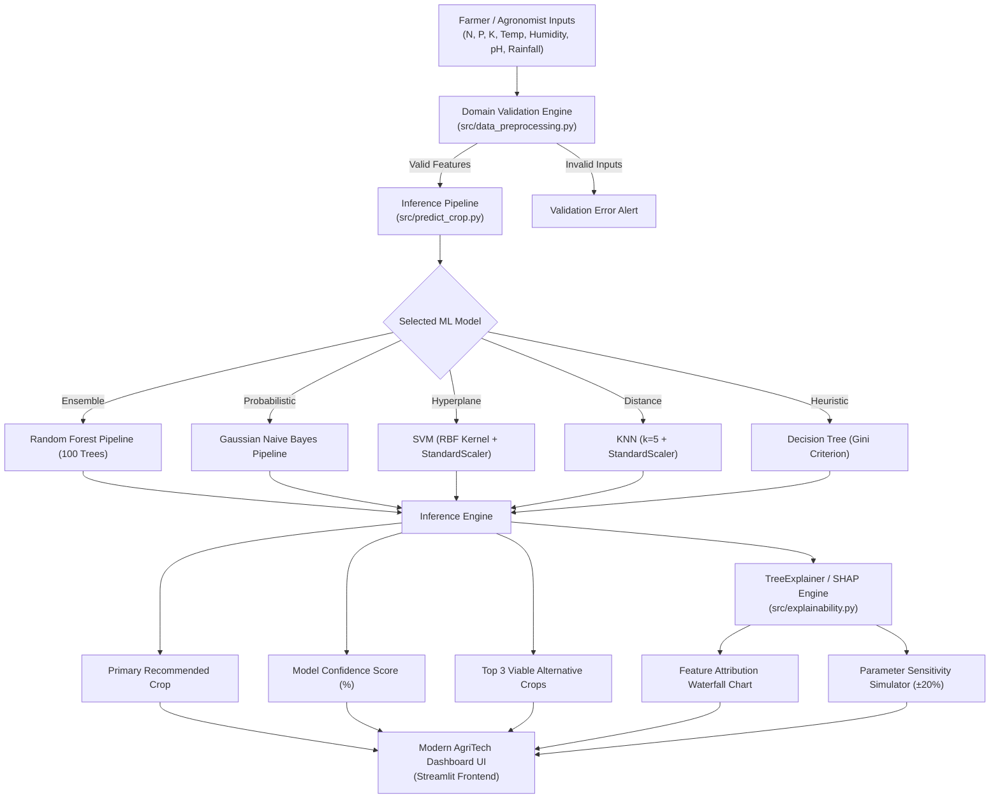

# 🌱 Smart Crop AI — Smart Crop Recommendation System Using Machine Learning

[](https://www.python.org/)
[](https://streamlit.io/)
[](https://scikit-learn.org/)
[](https://plotly.com/)
[](https://shap.readthedocs.io/)
[](LICENSE)

> **Academic Major Project:** B.Tech Artificial Intelligence and Machine Learning (AIML)  
> **Application Title:** Smart Crop AI — Intelligent Crop Selection Through Machine Learning

---

## 📌 Executive Summary

**Smart Crop AI** is an end-to-end, production-grade precision agriculture decision support platform engineered using supervised machine learning and Explainable Artificial Intelligence (XAI). By analyzing **macronutrient soil chemistry (Nitrogen, Phosphorus, Potassium)** alongside **ambient meteorological factors (Temperature, Relative Humidity, Soil pH, and Rainfall)**, the platform recommends the single most viable crop cultivar to maximize yield, optimize water usage, and safeguard soil fertility.

The project evaluates and compares five distinct classification paradigms:
1. **Random Forest Classifier** (Top Performer: **99.55% F1-Score**)
2. **Gaussian Naive Bayes** (**99.54% F1-Score**)
3. **Support Vector Machine (SVM)** (**98.87% F1-Score**)
4. **K-Nearest Neighbors (KNN)** (**98.16% F1-Score**)
5. **Decision Tree Classifier** (**97.94% F1-Score**)

Predictions are supplemented with **probabilistic confidence gauges**, **alternative crop recommendations**, **SHAP (SHapley Additive exPlanations) waterfall attribution charts**, **parameter sensitivity simulators**, and an agronomic knowledge base covering all 22 supported crops.

---

## 🎯 Problem Statement

Traditional agronomy and smallholder farming in developing regions frequently depend on inherited wisdom or regional monoculture trends. This unscientific crop selection triggers three critical systemic crises:
1. **Accelerated Soil Degradation:** Cultivating nutrient-exhaustive crops without adequate baseline N-P-K profiles causes severe chemical exhaustion.
2. **Climate Vulnerability & Crop Failure:** Sowing water-intensive crops in regions with erratic monsoon precipitation or planting humidity-sensitive crops in tropical dampness triggers widespread fungal blight and catastrophic financial distress.
3. **Groundwater Depletion:** Misaligned irrigation strategies over-exploit tube wells in arid belts where drought-tolerant coarse grains or pulses should have been cultivated.

**Smart Crop AI** addresses this challenge by framing crop selection as a multi-class supervised learning task, delivering data-driven certainty before farmers sow seeds.

---

## 🚀 Key Features

- **Multi-Algorithm Architecture:** Evaluates 5 industry-standard classifiers with automated pipelines and zero data leakage.
- **Interactive Crop Recommendation:** Sliders and numeric inputs for all 7 soil and climatic factors, pre-loaded agricultural test scenarios, and instant recommendation generation.
- **Probabilistic Certainty & Alternatives:** Real-time confidence gauge and top-3 candidate crop alternatives for flexible farmer decision-making.
- **Explainable AI (XAI) with SHAP:** Local game-theoretic feature attribution illustrating the exact positive (catalyst) and negative (inhibitor) forces behind each decision.
- **Sensitivity & Shift Simulation:** Real-time perturbation testing ($\pm20\%$) to test recommendation stability against weather variability.
- **Interactive Exploratory Data Analytics (EDA):** Grouped bar charts, parametric distribution curves, and Pearson correlation heatmaps powered by Plotly.
- **Crop Knowledge Base:** Comprehensive agronomic dossiers for all 22 supported crops, contrasting published agronomic standards with dataset-observed ranges.
- **Session Prediction Auditing:** In-memory session tracking with single-click CSV export.

---

## 🔬 System Architecture & Workflow



---

## 📊 Dataset Description

The system is trained and benchmarked on the curated **Crop Recommendation Dataset**:
- **Source:** Atharva Ingle / Kaggle Precision Agriculture Initiative.
- **Records:** Exactly `2,200` balanced samples.
- **Classes:** `22` crop types with exactly `100` samples per class.
- **Integrity:** `0` missing values, `0` duplicate records.

### Feature Specification Matrix

| Parameter | Unit | Physical Description | Minimum | Mean | Maximum |
| :--- | :--- | :--- | :---: | :---: | :---: |
| **Nitrogen ($N$)** | kg/ha | Available soil nitrogen content | 0.0 | 50.55 | 140.0 |
| **Phosphorus ($P$)** | kg/ha | Available soil phosphorus content | 5.0 | 53.36 | 145.0 |
| **Potassium ($K$)** | kg/ha | Available soil potassium content | 5.0 | 48.15 | 205.0 |
| **Temperature** | °C | Ambient ambient temperature | 8.83 | 25.62 | 43.68 |
| **Humidity** | % | Relative ambient air humidity | 14.26 | 71.48 | 99.98 |
| **Soil pH** | pH scale | Acidity or alkalinity of soil solution | 3.50 | 6.47 | 9.94 |
| **Rainfall** | mm | Seasonal / annual rainfall precipitation | 20.21 | 103.46 | 298.56 |

### Supported Crop Cultivars (22 Classes)
- **Cereals & Grains:** Rice, Maize
- **Pulses & Legumes:** Chickpea, Kidney Beans, Pigeon Peas, Moth Beans, Mung Bean, Black Gram, Lentil
- **Fruits & Horticulture:** Pomegranate, Banana, Mango, Grapes, Watermelon, Muskmelon, Apple, Orange, Papaya, Coconut
- **Commercial Cash & Fiber:** Cotton, Jute
- **Beverage Plantation:** Coffee

---

## 🏆 Model Evaluation & Benchmark Results

All models were evaluated using an **80/20 stratified train-test split** (1,760 training samples, 440 test samples) and verified via **5-Fold Stratified Cross-Validation**. Distance-sensitive models (KNN and SVM) utilize `StandardScaler` inside `sklearn.pipeline.Pipeline` to guarantee zero data leakage.

| Algorithm | Accuracy | Precision (Weighted) | Recall (Weighted) | F1-Score (Weighted) | 5-Fold CV Accuracy |
| :--- | :---: | :---: | :---: | :---: | :---: |
| 🌲 **Random Forest Classifier** | **99.55%** | **99.57%** | **99.55%** | **99.55%** | **99.38% ± 0.61%** |
| 📊 **Gaussian Naive Bayes** | 99.55% | 99.59% | 99.55% | 99.54% | 99.49% ± 0.42% |
| ⚡ **Support Vector Machine (SVM)** | 98.86% | 98.96% | 98.86% | 98.87% | 98.24% ± 0.49% |
| 📍 **K-Nearest Neighbors (KNN)** | 98.18% | 98.29% | 98.18% | 98.16% | 96.82% ± 1.17% |
| 🌿 **Decision Tree Classifier** | 97.95% | 98.06% | 97.95% | 97.94% | 98.52% ± 0.68% |

### Why Random Forest Performs Best
Agricultural parameters feature complex multi-threshold interactions. For example, paddy cultivation requires high rainfall ($>200\text{ mm}$) combined with high humidity ($>80\%$), while chickpeas require low humidity ($<40\%$) and cool temperatures. Random Forest constructs 100 decorrelated decision trees that partition this non-linear hyperspace effectively while neutralizing variance through bootstrap aggregation.

---

## 📁 Project Folder Structure

```
Smart-Crop-Recommendation/
│
├── app.py                         # Application main entry point
│
├── pages/
│   ├── 1_Home.py                  # Module 1: Project overview, KPIs, and architecture
│   ├── 2_Crop_Recommendation.py   # Module 2: Interactive inference, gauges & radar charts
│   ├── 3_Model_Comparison.py      # Module 4: 5-model statistical benchmark & confusion matrices
│   ├── 4_Data_Analytics.py        # Module 5: Parametric distributions & correlation heatmaps
│   ├── 5_Explainable_AI.py        # Module 6: SHAP attribution & parameter sensitivity analysis
│   └── 6_Crop_Information.py      # Module 7: Agronomic profiles & dataset vs. literature matrix
│
├── data/
│   └── crop_recommendation.csv    # Official curated 2200-record dataset
│
├── models/
│   ├── best_model.pkl             # Serialized top model (Random Forest)
│   ├── random_forest.pkl          # Serialized Random Forest pipeline
│   ├── decision_tree.pkl          # Serialized Decision Tree pipeline
│   ├── naive_bayes.pkl            # Serialized Gaussian Naive Bayes pipeline
│   ├── knn.pkl                    # Serialized KNN pipeline with scaler
│   ├── svm.pkl                    # Serialized SVM pipeline with scaler
│   ├── preprocessor.pkl           # Standalone fitted StandardScaler
│   └── metrics.json               # Full evaluation metrics and classification reports
│
├── src/
│   ├── __init__.py
│   ├── data_preprocessing.py      # Loading, validation, bounds checking, stratified split
│   ├── train_models.py            # Model definitions, cross-validation, and training script
│   ├── predict_crop.py            # Inference engine with confidence & alternatives
│   ├── evaluate_models.py         # Precision, recall, f1, cv, confusion matrix logic
│   └── explainability.py          # SHAP TreeExplainer and sensitivity simulator
│
├── utils/
│   ├── __init__.py
│   ├── visualizations.py          # Plotly gauge, radar, waterfall, and heatmap charts
│   ├── crop_information.py        # 22-crop agronomic database & empirical extractor
│   └── helpers.py                 # Page initialization, custom CSS injector, session history
│
├── assets/
│   ├── style.css                  # Custom Emerald/Forest Green AgriTech design system
│   └── logo.png                   # High-resolution agricultural brand mark
│
├── requirements.txt               # Locked dependencies
├── README.md                      # Comprehensive project documentation
└── .gitignore                     # Git ignore rules
```

---

## 💻 Installation & Setup

### 1. Prerequisites
- **Python 3.11 or Python 3.12** installed on your system.
- Git installed.

### 2. Clone the Repository
```bash
git clone https://github.com/your-username/smart-crop-recommendation.git
cd smart-crop-recommendation
```

### 3. Create and Activate Virtual Environment
```bash
# macOS / Linux
python3 -m venv .venv
source .venv/bin/activate

# Windows (Command Prompt)
python -m venv .venv
.venv\Scripts\activate.bat

# Windows (PowerShell)
.venv\Scripts\Activate.ps1
```

### 4. Install Dependencies
```bash
pip install --upgrade pip
pip install -r requirements.txt
```

---

## ⚡ Execution Instructions

### Run the Application
Start the Streamlit application using a single command:
```bash
streamlit run app.py
```
The browser will automatically open at `http://localhost:8501`.

### (Optional) Retrain Machine Learning Models
To retrain all five models from scratch and regenerate `models/metrics.json`:
```bash
python src/train_models.py
```

---

## 🖥️ Application Walkthrough

### 1. Home Dashboard (`1_Home.py`)
- High-level KPIs, project problem statement, end-to-end system workflow, quick module navigation, and benchmark overview.

### 2. Crop Recommendation Engine (`2_Crop_Recommendation.py`)
- Interactive dual-column sliders for NPK and environmental factors.
- Pre-loaded agricultural test scenarios (e.g. Paddy, Cotton, Apple, Coffee).
- Prominent recommended crop card, confidence speedometer gauge, and viable alternatives.
- Normalized radar chart comparing user inputs against crop benchmarks.
- In-memory session history table with CSV export.

### 3. Model Comparison (`3_Model_Comparison.py`)
- Side-by-side grouped bar charts for Accuracy, Precision, Recall, and F1-Score.
- 22x22 interactive Confusion Matrix heatmap for any selected model.
- Detailed classification report with class-level support.
- Deep theoretical analysis explaining why each algorithm behaves as observed.

### 4. Data Analytics Dashboard (`4_Data_Analytics.py`)
- Full dataset preview and descriptive statistics.
- Perfectly balanced class distribution graph.
- Pearson correlation heatmap between soil nutrients and climatic variables.
- Parametric distribution histograms with marginal box plots.
- Cross-crop box plot comparisons and bivariate scatter plots.

### 5. Explainable AI (`5_Explainable_AI.py`)
- Global Gini impurity feature importance ranking.
- Local SHAP waterfall / bidirectional bar chart illustrating exact force vectors for individual predictions.
- Parameter sensitivity simulator examining shifts caused by $\pm20\%$ climatic variations.
- Prominent scientific disclaimer on correlation vs. biological causation.

### 6. Crop Knowledge Base (`6_Crop_Information.py`)
- Filterable directory of all 22 supported crops.
- Complete agronomic profile: scientific classification, season, soil suitability, and field cultivation practices.
- Dual-table comparing published agronomic literature against dataset-derived empirical statistics.
- Full 22-crop master agronomic reference table.

---

## 🔮 Future Scope & Enhancements

1. **IoT Sensor Ingestion:** Integrating real-time telemetry from soil NPK probes (LoRaWAN/ESP32) and IoT weather stations.
2. **Satellite & Geolocation Fusion:** Automatic retrieval of local climate, NDVI, and weather forecasts via Open-Meteo or Google Earth Engine APIs based on GPS coordinates.
3. **Multilingual Farmer Interface:** Localization into regional agricultural languages (Hindi, Telugu, Tamil, Marathi, Punjabi, Bengali) with voice guidance.
4. **Mobile PWA Deployment:** Wrapping the frontend into a responsive Progressive Web App for offline field usage.

---

## 👥 Project Credits & Academic Context

- **Academic Program:** Bachelor of Technology (B.Tech) in Artificial Intelligence & Machine Learning
- **Core Focus:** Precision Agriculture, Supervised Machine Learning, Decision Support Systems, and Explainable AI (XAI)
- **Status:** Complete, fully functional, and production-ready for academic evaluation and GitHub showcase.
